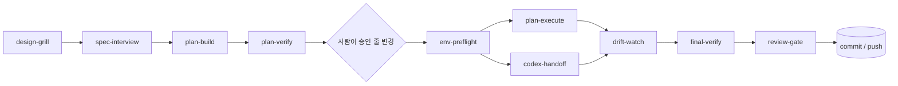

# contract-first-harness

계약을 먼저 굳히고, 플랜을 반증하고, 사람이 승인한 플랜만 실행하고, 태스크마다 이탈을 잡는 Claude Code 개발 하네스입니다.

스킬 12개, PreToolUse 훅 2개, 세션 비용 측정 스크립트 1개로 이뤄진 Claude Code 플러그인입니다. AI 코딩 에이전트가 틀리는 지점(계약이 늦게 굳어 병렬 구현이 어긋남, 플랜이 부풀어 비용이 커짐, 근거 없는 주장, 사람이 보지 않은 변경의 커밋)을 프롬프트가 아니라 파일 계약과 훅으로 막습니다.

## 흐름



| 단계 | 스킬 | 하는 일 | 남기는 것 |
|---|---|---|---|
| 설계 캐묻기 | `design-grill` | 설계안을 결정 트리로 캐묻되 트레이드오프, 오류 환경, 엣지 케이스, 확장성 같은 품질 관점을 트리의 뿌리로 먼저 둡니다. 비어 있는 관점이 있으면 끝내지 않습니다 | 없음 |
| 계약 확정 | `spec-interview` | 환경에서 찾을 수 있는 사실은 직접 조회하고 사람에게는 결정만 하나씩 묻습니다. 인터페이스, DTO, 이벤트, DB, 에러 코드 계약을 먼저 굳히고, 닫기 직전 빠진 결정이 없는지 한 번 더 엽니다 | `spec/<slug>.md` |
| 플랜 작성 | `plan-build` | 계약 고정, 구현, 통합 세 구간으로 나누고 태스크마다 건드리는 파일, 수정 금지 경로, 의존성, 병렬 여부를 적습니다. 150줄, 태스크당 파일 3개, 태스크 12개 상한 | `plan/<slug>.md` |
| 플랜 반증 | `plan-verify` | 전제, 태스크, 계약, 병렬(양방향), 누락 다섯 관점마다 반증 서브에이전트를 병렬로 띄웁니다. 기본 판정은 기각이고 근거 인용이 필수입니다 | 플랜 안 검증 결과 절 |
| 사람 승인 | (훅) | 플랜 상단의 승인 줄을 사람이 바꿉니다. AI의 변경은 `approval-gate` 훅이 막습니다 | 승인 줄 |
| 환경 점검 | `env-preflight` | 저장소 위치, 런타임, 빌드 도구, DB와 브로커 접속, 포트, 필수 env를 착수 전에 실측합니다 | `report/preflight-<slug>-<날짜>.md` |
| 구현 | `plan-execute` / `codex-handoff` | 의존성 순서로 실행합니다. 파일마다 쓰는 사람은 한 명이고, 플랜에 없는 일을 하게 되면 멈춥니다. Codex에 넘길 때는 `codex exec` 한 줄로 넘기고 플랜, git diff, 출력 파일을 대조해 회수합니다 | 체크박스, `report/codex-*.md` |
| 이탈 감지 | `drift-watch` | 태스크가 끝날 때 한 번, 그 태스크가 건드린 파일만 보고 근거 없는 주장, spec과 plan 이탈, 수정 금지 경로 침범을 찾습니다. 고치지 않고 묻고 멈춥니다 | `report/drift-*.md` (감지했을 때만) |
| 종료 검증 | `final-verify` | 규칙, 아키텍처, 요구사항 3층을 서브에이전트로 병렬 검증하고, 메인이 실제 기동과 깨끗한 사본 기동을 직접 확인합니다 | `report/verify-<slug>-<날짜>.md` |
| 사람 확인 커밋 | `review-gate` | 사람이 직접 남긴 확인 기록이 코드 트리에 없으면 커밋, push, PR/MR 생성을 막습니다 | git-dir 안 기록 |
| 비용 측정 | `harness-metrics` | 세션 로그에서 토큰, 캐시 히트율, 비용, 정정률을 뽑아 플랜 있음과 없음을 A/B로 판정합니다 | 표준 출력 |

산출물은 모두 대상 저장소의 `.claude/harness/` 아래에 생깁니다.

## 설치

```
/plugin marketplace add iohyeon/contract-first-harness
/plugin install contract-first-harness@iohyeon
```

필요한 것: Claude Code, bash, git 2.13 이상, jq. `codex-handoff`를 쓰려면 Codex CLI가 필요합니다.

## 사용법

### 1. 계약과 플랜

```
> spec-interview로 주문 취소 API 요구사항을 정리하자
> plan-build로 플랜 만들어 줘
> plan-verify로 플랜을 깨 봐
```

### 2. 사람이 승인합니다

`plan-verify`가 끝나면 플랜 상단에 미승인 줄이 남습니다. 검토 후 직접 바꿉니다.

```
**승인**: 미승인
```

```
**승인**: 승인 2026-11-16 결제 실패 분기 확인함
```

승인 판정 정규식은 `^\*\*승인\*\*:[[:space:]]*승인[[:space:]]*\(?[0-9]{4}-[0-9]{2}-[0-9]{2}` 이고, 플랜의 앞 20줄 안에 있어야 합니다.

### 3. 실행

```
> plan-execute로 진행해 줘
```

`plan-execute`와 `codex-handoff`는 착수할 때 `.claude/harness/active-plan`에 플랜 경로를 씁니다. 이 파일이 가리키는 플랜이 승인되지 않았으면 `approval-gate` 훅이 `.claude/harness/` 밖의 편집과 `codex exec`를 막습니다.

### 4. 사람 확인 커밋 게이트 (저장소별로 켭니다)

```
! review-gate enable
```

켜진 저장소에서는 커밋 전에 사람이 직접 기록을 남겨야 합니다. 기록은 현재 작업 트리의 트리 해시에 묶이므로, 기록 후 한 줄이라도 바뀌면 다시 확인해야 합니다.

```
! review-gate status
! review-gate record code "주문 취소 서비스와 테스트 읽음. 환불 금액 반올림 확인"
! review-gate record query "SELECT ... 실행, 1,204행 0.08초, 인덱스 사용 확인"
```

- `query` 기록은 바뀐 파일 중 쿼리 파일(기본 `*.sql`, `*Mapper.xml`)이 있을 때만 요구합니다. 패턴은 `git config --add review-gate.query-pattern '<glob>'`으로 바꿉니다.
- 급할 때는 사람과 이유를 문답한 뒤 `record loose "<이유>"`로 넘길 수 있습니다.
- 기록은 `$(git rev-parse --git-dir)/review-gate/`에 생겨 커밋되지 않습니다.
- 모델이 `review-gate record`를 실행하거나 기록 폴더에 쓰는 것은 훅이 막습니다. 기록은 `!`로 사람이 남깁니다.

### 5. 비용 측정

```
bash skills/harness-metrics/scripts/cc-usage.sh --subagents <프로젝트 폴더>
bash skills/harness-metrics/scripts/cc-usage.sh --group-a <세션ID들> --group-b <세션ID들>
```

로그 위치는 `${CLAUDE_CONFIG_DIR:-~/.claude}/projects`이고 `--root`로 바꿀 수 있습니다. 단가는 추정값이며 `HM_PRICE_INPUT`, `HM_PRICE_OUTPUT`, `HM_PRICE_CACHE_WRITE`, `HM_PRICE_CACHE_READ`(USD, 100만 토큰당)로 덮어씁니다. 판정은 같은 종류의 작업으로 최소 2쌍을 비교한 뒤에 내립니다.

## 설계 판단

- **병렬 판정의 입증 책임을 뒤집었습니다.** 직렬로 둘 근거를 대지 못하면 병렬로 봅니다. 서브에이전트는 서로 대화하지 못하므로, 계약 확정은 품질 규율이 아니라 병렬이 성립하는 전제입니다.
- **사람 게이트는 파일 안의 한 줄입니다.** 승인은 대화 속 합의가 아니라 기계가 읽는 마커이고, 훅이 AI의 변경을 막습니다.
- **검증자의 지적도 틀릴 수 있다고 봅니다.** 반증 에이전트의 기본 판정은 기각이고, 근거를 인용하지 못한 지적은 버립니다. 반박이 오면 앞선 판정을 모르는 에이전트가 다시 판정합니다.
- **검증의 횟수와 범위에 상한을 둡니다.** `drift-watch`는 태스크당 한 번, 그 태스크의 파일만 봅니다. 감지가 없으면 파일도 만들지 않습니다. 세션 비용 대부분이 컨텍스트 재사용이라 상시 검증은 비싸기 때문입니다.
- **구현자와 검증자를 다른 프로세스로 나눕니다.** Codex가 구현하면 Claude는 대화 기록 없이 플랜, diff, 출력 파일만으로 회수합니다.
- **확인 기록을 코드 트리 해시에 묶습니다.** "확인했다"는 말이 아니라 어떤 트리를 확인했는지가 기록됩니다.

## 비슷한 도구와의 차이

| 도구 | 다루는 것 | 이 플러그인이 더하는 것 |
|---|---|---|
| obra/superpowers | brainstorming, 플랜 작성, 실행, 완료 전 검증 | 플랜 자체의 적대적 반증, 훅으로 강제되는 승인 마커, 태스크 단위 이탈 감지 |
| github/spec-kit | specify, plan, tasks, implement | 계약 확정을 병렬의 전제로 두는 태스크 분할, 실제 기동까지 보는 종료 검증 |
| ccusage | 토큰과 비용 집계 | 세션 그룹 A/B 비교와 정정률 같은 품질 대리 지표 |

## 훅의 동작 범위

훅은 도구 호출의 입력 문자열과 경로를 검사합니다. 변수나 다른 스크립트를 거쳐 우회하는 명령까지 해석하지는 않습니다. `approval-gate`는 Bash에서 `codex exec`와 승인 줄 조작만 막고, 셸 리다이렉션 쓰기는 막지 않습니다. 강제력은 "실수로 넘어가지 않게" 하는 수준으로 설계했습니다.

## 개발

```
bash tests/run.sh
```

macOS 기본 bash 3.2와 GNU bash에서 동작하도록 연관 배열과 `mapfile`을 쓰지 않았습니다. 테스트는 임시 git 저장소와 가짜 세션 로그로 돌고 실제 사용자 데이터를 쓰지 않습니다.

## 라이선스

MIT. `skills/grilling`은 [mattpocock/skills](https://github.com/mattpocock/skills)(MIT)에서 가져왔습니다. 자세한 내용은 `NOTICE`에 있습니다.
