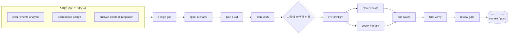

# contract-first-harness

계약을 먼저 굳히고, 플랜을 반증하고, 사람이 승인한 플랜만 실행하고, 태스크마다 이탈을 잡는 Claude Code 개발 하네스입니다.

이 하네스는 실무에서 AI 코딩 에이전트를 쓰며 실제로 겪은 실패에서 나왔습니다. 단계마다 어떤 실수를 막는지, 그 규칙이 어떤 사건에서 생겼는지를 함께 적었습니다. 규칙은 프롬프트에만 두지 않고, 꼭 지켜야 하는 것은 파일 계약과 PreToolUse 훅으로 강제합니다.

스킬 15개, 훅 2개, 세션 비용 측정 스크립트 1개로 이뤄진 Claude Code 플러그인입니다.

## 흐름



## 단계별로 막는 실수

출처 사건은 실무에서 겪은 일을 회사와 제품을 빼고 일반화해 적었습니다.

| 단계 | 스킬과 도구 | 막는 실수 | 출처 사건 |
|---|---|---|---|
| 요구사항 (해당 시) | `requirements-analysis` | 문장으로 받은 요구사항을 그대로 믿고 구현해, 애매한 지점이 구현 뒤에 드러나는 것 | 요구사항을 문제 상황으로 다시 읽고 질문으로 합의하는 습관을 스킬로 옮김 |
| 커머스 설계 (해당 시) | `ecommerce-design` | 판매 형태, 재고 정본, 차감 시점, 스냅샷 경계, 취소 순서, 멱등키, 금액 안분, 상태 전이를 정하지 않은 채 스키마와 API부터 만드는 것 | 커머스 도메인 학습에서 정리한 확정 항목 10개(G1~G10)를 설계 전 게이트로 만듦 |
| 외부 연동 (해당 시) | `analyze-external-integration` | 결제나 서드파티 호출을 트랜잭션 안에 두거나, 응답 유실과 재시도와 중복 실행을 따지지 않는 것 | 외부 호출 직후의 실패가 데이터 불일치로 이어지는 유형을 설계 리뷰 단계에서 잡도록 함 |
| 설계 캐묻기 | `design-grill`, `grilling` | 정상 경로만 있는 설계 | 트레이드오프, 오류 환경, 엣지 케이스, 확장성 같은 관점이 비어 있으면 끝내지 않음 |
| 계약 확정 | `spec-interview` | 서브에이전트들이 정해지지 않은 인터페이스를 각자 다른 값으로 채우는 것 | 병렬 구현의 어긋남이 통합 시점에야 드러남. 서브에이전트는 서로 대화하지 못함 |
| 플랜 작성 | `plan-build` | 플랜이 설계서가 되어 구현만큼 비싸지는 것 | 지난 플랜 문서가 한 편에 726~2,489줄이었고 매 세션 다시 읽혔음. 150줄 상한을 둠 |
| 플랜 반증 | `plan-verify` | 쓴 세션이 자기 플랜을 검증하는 것. 검증자의 근거 없는 지적 | 같은 모델의 두 세션이 같은 코드를 보고 다른 결론을 냄. 쓰는 세션은 자기 설명을 뒷받침하는 줄에서 멈춤 |
| 사람 승인 | `approval-gate` 훅 | 사람이 보기 전에 AI가 실행을 시작하는 것 | 승인 규칙을 지시문으로만 두었을 때, 형식이 다른 승인 줄로도 실행이 진행됨 |
| 환경 점검 | `env-preflight` | 설계로는 보이지 않고 명령을 돌려야 드러나는 환경 문제를 착수 뒤에 발견하는 것 | 빌드 컨테이너가 root로 돌아 캐시 소유권이 바뀌어 git이 막혔고, 저장소 루트가 홈 디렉터리라 설정 폴더가 산출물에 섞일 뻔함 |
| 구현 | `plan-execute`, `codex-handoff` | 플랜에 없는 일을 조용히 하는 것. 여러 작업자가 같은 파일을 쓰는 것 | 정지 조건 8개와 파일마다 쓰는 사람 한 명 규칙. Codex 구현은 대화 기록 없이 플랜, diff, 출력 파일로만 회수 |
| 이탈 감지 | `drift-watch` | 근거 없는 주장, spec과 plan 이탈, 수정 금지 경로 침범이 다음 태스크로 번지는 것 | 처음엔 상시 감시였으나 세션 비용의 84%가 캐시 읽기라 태스크당 한 번으로 바꿈 |
| 종료 검증 | `final-verify` | 테스트는 통과했는데 실제로는 뜨지 않는 결과물 | 컴파일과 단위 테스트는 통과했지만, 생성자가 여럿인 빈의 주입 대상이 정해지지 않아 애플리케이션 컨텍스트 기동에서만 실패함. 기동 층을 추가 |
| 커밋 | `review-gate` 훅 | 사람이 읽지 않은 쿼리와 코드가 리뷰로 올라가는 것 | 목적을 설명하지 못하는 테이블과 테이블 전체를 읽는 조인이 리뷰까지 그대로 올라감 |
| 측정 | `harness-metrics` | 하네스가 비용만큼 값을 하는지 모르고 단계를 늘리는 것 | 단계마다 비용과 정정률을 세션 로그로 잼 |

산출물은 모두 대상 저장소의 `.claude/harness/` 아래에 생깁니다.

| 경로 | 쓰는 스킬 |
|---|---|
| `domain/<slug>.md` | 도메인 게이트 3개 (각자 자기 절을 붙임) |
| `spec/<slug>.md` | spec-interview |
| `plan/<slug>.md` | plan-build, plan-verify (검증 결과 절) |
| `active-plan` | plan-execute, codex-handoff (실행 중에만) |
| `report/preflight-*.md`, `drift-*.md`, `codex-*.md`, `verify-*.md` | env-preflight, drift-watch, codex-handoff, final-verify |

## 규칙이 틀렸을 때 고친 이력

하네스도 틀립니다. 틀린 것을 찾았을 때 무엇을 바꿨는지 남깁니다.

| 틀린 것 | 드러난 방식 | 바꾼 것 |
|---|---|---|
| 승인 규칙이 지시문에만 있었음 | 실제 플랜의 승인 줄이 정해진 형식과 달랐는데 실행이 진행됨 | `approval-gate` 훅으로 강제. 예전 형식도 승인으로 읽도록 정규식을 넓힘 |
| 검증이 테스트에서 멈춤 | 단위 테스트는 컨텍스트를 띄우지 않아, 기동에서만 드러나는 결함을 놓침 | `final-verify`에 기동 층(컨텍스트 기동, 컨테이너, 실제 HTTP, 새 사본 기동) 추가. 통합은 하나씩 붙이고 그 자리에서 기동 |
| 담당 경로만 주고 금지는 주지 않음 | 병렬 작업자가 "필요해 보여서" 다른 작업자의 영역을 고침. 금지 목록을 함께 준 뒤에야 지켜짐 | `plan-build` 태스크 표에 수정 금지 열, `drift-watch`에 수정 금지 경로 기계 대조 |
| 환경 확인이 착수 뒤에 일어남 | 컨테이너 권한과 저장소 루트 위치 문제를 작업 도중에 발견함 | `env-preflight` 신설, 착수 전 호출 |
| 설계 논의 시간 상한을 지시로만 둠 | 상한이 지켜지지 않고 논의가 세 라운드로 늘어남. 대신 닫기 직전 "추가 질문은 지금 한 번에"라고 열자 빠진 컬럼이 병렬 착수 전에 나옴 | `spec-interview`에 닫기 전 한 번 다시 여는 단계. 시간 상한에는 효과를 기대하지 않음 |
| 상시 이탈 감시가 비쌌음 | 세션 로그 측정에서 비용 대부분이 컨텍스트 재사용 | `drift-watch`를 태스크당 한 번, 해당 파일만으로 제한 |
| 리뷰 기록 요청이 커밋마다 끊김 | 커밋마다 기록 명령을 주고받아 흐름이 끊김 | `review-gate` 확인 요청을 개발 단위당 한 번으로 묶음. 쿼리 파일이 바뀐 경우에만 쿼리 확인 요구 |

## 설치

```
/plugin marketplace add iohyeon/contract-first-harness
/plugin install contract-first-harness@iohyeon
```

필요한 것: Claude Code, bash, git 2.13 이상, jq. `codex-handoff`를 쓰려면 Codex CLI가 필요합니다.

## 사용법

### 1. 도메인 게이트 (해당할 때만)

```
> requirements-analysis로 이 요구사항부터 정리하자
> ecommerce-design으로 주문 취소 설계 전제를 확정하자
> analyze-external-integration으로 PG 연동 리스크를 보자
```

세 게이트는 `.claude/harness/domain/<slug>.md`에 각자 절을 붙이고, 절마다 `확정된 결정`과 `열린 질문`을 남깁니다. 다음 단계의 `spec-interview`는 확정된 결정을 다시 묻지 않고 열린 질문부터 인터뷰합니다. 해당하지 않으면 건너뛰고 바로 `spec-interview`로 갑니다.

### 2. 계약과 플랜

```
> spec-interview로 주문 취소 API 계약을 정하자
> plan-build로 플랜 만들어 줘
> plan-verify로 플랜을 깨 봐
```

### 3. 사람이 승인합니다

`plan-verify`가 끝나면 플랜 상단에 미승인 줄이 남습니다. 검토 후 직접 바꿉니다.

```
**승인**: 미승인
```

```
**승인**: 승인 2026-11-16 결제 실패 분기 확인함
```

승인 판정 정규식은 `^\*\*승인\*\*:[[:space:]]*승인[[:space:]]*\(?[0-9]{4}-[0-9]{2}-[0-9]{2}` 이고, 플랜의 앞 20줄 안에 있어야 합니다. AI가 이 줄을 승인으로 바꾸는 편집은 훅이 막습니다.

### 4. 실행

```
> plan-execute로 진행해 줘
```

`plan-execute`와 `codex-handoff`는 착수할 때 `.claude/harness/active-plan`에 플랜 경로를 씁니다. 이 파일이 가리키는 플랜이 승인되지 않았으면 `approval-gate` 훅이 `.claude/harness/` 밖의 편집과 `codex exec`를 막습니다.

### 5. 사람 확인 커밋 게이트 (저장소별로 켭니다)

```
! review-gate enable
```

켜진 저장소에서는 커밋 전에 사람이 직접 기록을 남겨야 합니다. 기록은 현재 작업 트리의 트리 해시에 묶이므로, 기록 후 한 줄이라도 바뀌면 다시 확인해야 합니다.

```
! review-gate status
! review-gate record code "주문 취소 서비스와 테스트 읽음. 환불 금액 반올림 확인"
! review-gate record query "SELECT ... 실행, 1,204행 0.08초, 인덱스 사용 확인"
```

- `query` 기록은 바뀐 파일 중 쿼리 파일(기본 `*.sql`, `*Mapper.xml`)이 있을 때만 요구합니다. 패턴은 `git config --add review-gate.query-pattern '<glob>'`으로 바꿉니다.
- 급할 때는 사람과 이유를 문답한 뒤 `record loose "<이유>"`로 넘길 수 있습니다.
- 기록은 `$(git rev-parse --git-dir)/review-gate/`에 생겨 커밋되지 않습니다.
- 모델이 `review-gate record`를 실행하거나 기록 폴더에 쓰는 것은 훅이 막습니다. 기록은 `!`로 사람이 남깁니다.

### 6. 비용과 효과 측정

```
bash skills/harness-metrics/scripts/cc-usage.sh --subagents <프로젝트 폴더>
bash skills/harness-metrics/scripts/cc-usage.sh --group-a <세션ID들> --group-b <세션ID들>
```

로그 위치는 `${CLAUDE_CONFIG_DIR:-~/.claude}/projects`이고 `--root`로 바꿀 수 있습니다. 단가는 추정값이며 `HM_PRICE_INPUT`, `HM_PRICE_OUTPUT`, `HM_PRICE_CACHE_WRITE`, `HM_PRICE_CACHE_READ`(USD, 100만 토큰당)로 덮어씁니다.

효과 측정 절차는 [docs/measurement.md](docs/measurement.md)에 있습니다. 비슷한 크기의 기능 2개를 하네스 있음과 없음으로 순서를 바꿔 가며 재고, 게이트가 낸 지적은 원문을 보존한 채 사람이 하나씩 판정하며, 기각한 지적 수도 공개합니다. 결과는 통계가 아니라 사례로 표기합니다.

## 설계 판단

- **병렬 판정의 입증 책임을 뒤집었습니다.** 직렬로 둘 근거를 대지 못하면 병렬로 봅니다. 서브에이전트는 서로 대화하지 못하므로, 계약 확정은 품질 규율이 아니라 병렬이 성립하는 전제입니다.
- **사람 게이트는 파일 안의 한 줄입니다.** 승인은 대화 속 합의가 아니라 기계가 읽는 마커이고, 훅이 AI의 변경을 막습니다.
- **검증자의 지적도 틀릴 수 있다고 봅니다.** 반증 에이전트의 기본 판정은 기각이고, 근거를 인용하지 못한 지적은 버립니다. 반박이 오면 앞선 판정을 모르는 에이전트가 다시 판정합니다.
- **검증의 횟수와 범위에 상한을 둡니다.** `drift-watch`는 태스크당 한 번, 그 태스크의 파일만 봅니다. 감지가 없으면 파일도 만들지 않습니다.
- **구현자와 검증자를 다른 프로세스로 나눕니다.** Codex가 구현하면 Claude는 대화 기록 없이 플랜, diff, 출력 파일만으로 회수합니다.
- **확인 기록을 코드 트리 해시에 묶습니다.** "확인했다"는 말이 아니라 어떤 트리를 확인했는지가 기록됩니다.
- **도메인 판단은 선택 단계로 둡니다.** 커머스와 외부 연동 기준은 해당하는 작업에서만 강제하고, 그 결과는 spec의 확정된 결정으로 넘어갑니다.

## 훅의 동작 범위

훅은 도구 호출의 입력 문자열과 경로를 검사합니다. 변수나 다른 스크립트를 거쳐 우회하는 명령까지 해석하지는 않습니다. `approval-gate`는 Bash에서 `codex exec`와 승인 줄 조작만 막고, 셸 리다이렉션 쓰기는 막지 않습니다. 강제력은 "실수로 넘어가지 않게" 하는 수준으로 설계했습니다.

## 개발

```
bash tests/run.sh
```

- 훅, CLI, 측정 스크립트 테스트와 공개 검사(`tests/lint/`)가 함께 돕니다. CI는 Ubuntu와 macOS에서 테스트를 돌리고 shellcheck를 실행합니다.
- 공개 검사는 개인 홈 경로, 사설 IP, 시크릿 모양 문자열, 문서 문체, SKILL.md 형식 같은 일반 패턴만 봅니다. 조직 고유 단어는 레포에 두지 않고, `CFH_DENYLIST` 환경 변수로 레포 밖 목록 파일(한 줄에 하나)을 지정해 로컬에서 함께 검사합니다.
- macOS 기본 bash 3.2에서도 돌도록 연관 배열과 `mapfile`을 쓰지 않았습니다. 테스트는 임시 git 저장소와 가짜 세션 로그로 돌고 실제 사용자 데이터를 쓰지 않습니다.

## 비슷한 도구와의 차이

| 도구 | 다루는 것 | 이 플러그인이 더하는 것 |
|---|---|---|
| obra/superpowers | brainstorming, 플랜 작성, 실행, 완료 전 검증 | 플랜 자체의 적대적 반증, 훅으로 강제되는 승인 마커, 태스크 단위 이탈 감지 |
| github/spec-kit | specify, plan, tasks, implement | 도메인 게이트, 계약 확정을 병렬의 전제로 두는 태스크 분할, 실제 기동까지 보는 종료 검증 |
| ccusage | 토큰과 비용 집계 | 세션 그룹 A/B 비교와 정정률 같은 품질 대리 지표 |

## 라이선스

MIT. `skills/grilling`은 [mattpocock/skills](https://github.com/mattpocock/skills)(MIT)에서 가져왔습니다. 자세한 내용은 `NOTICE`에 있습니다.
